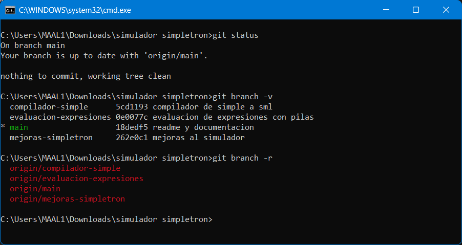
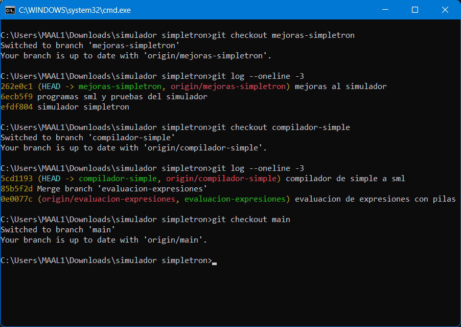
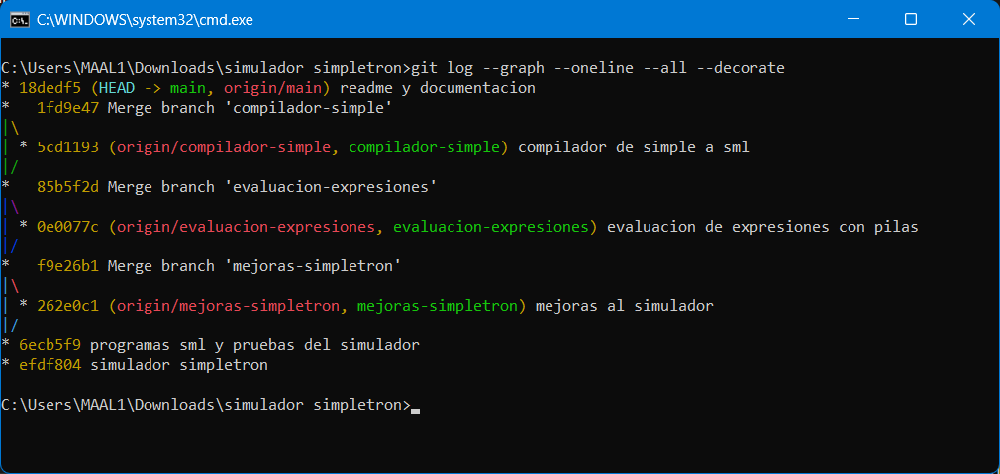

# Bitácora de trabajo con ramas

Registro de la práctica de ramas de Git en este proyecto. Cada componente se trabajó en su
propia rama y después se unió a `main`.

La transcripción de los comandos y sus salidas está en [`comandos-git.txt`](comandos-git.txt)
y el grafo de las ramas en [`historial-ramas.txt`](historial-ramas.txt).

## Capturas de la práctica

**Ramas locales y remotas.** `git status` muestra que `main` está al día con GitHub,
`git branch -v` lista las cuatro ramas locales con su último commit y `git branch -r` las
cuatro ramas del repositorio remoto.



**Cambio entre ramas.** Con `git checkout` se pasa de una rama a otra, y `git log` muestra el
commit que tiene cada rama.



**Historial.** El grafo completo: cada rama sale de `main`, tiene su commit y se une de nuevo
con un merge.



## Ramas

| Rama | Contenido |
|---|---|
| `main` | Simulador base, programas SML, pruebas y documentación |
| `mejoras-simpletron` | Las ocho modificaciones de la Sección 3 |
| `evaluacion-expresiones` | Validación, conversión infija a postfija y evaluación |
| `compilador-simple` | Compilador de Simple a SML |

## Grafo del historial

```
*   Merge branch 'compilador-simple'
|\
| * compilador de simple a sml
|/
*   Merge branch 'evaluacion-expresiones'
|\
| * evaluacion de expresiones con pilas
|/
*   Merge branch 'mejoras-simpletron'
|\
| * mejoras al simulador
|/
* programas sml y pruebas del simulador
* simulador simpletron
```

Los merges se hicieron con `--no-ff` para que cada rama quede visible en el grafo. Sin esa
opción, Git hace un *fast-forward* y el historial se ve como una sola línea.

## 1. Crear una rama

```bash
git checkout -b mejoras-simpletron
```

```
Switched to a new branch 'mejoras-simpletron'
```

`-b` crea la rama y se cambia a ella en un solo paso. Es lo mismo que `git branch` seguido de
`git checkout`. Igual se crearon `evaluacion-expresiones` y `compilador-simple`.

## 2. Commits en la rama

Estando en `mejoras-simpletron`:

```bash
git add src/simpletron/simpletron_mejorado.c programa.simp programas/sml/mejoras pruebas/mejoras
git commit -m "mejoras al simulador"
```

Ese commit queda solo en la rama. Al regresar a `main` esos archivos desaparecen de la carpeta,
porque `main` todavía no los tiene.

## 3. Cambiar de rama

```bash
git checkout main
```

```
Switched to branch 'main'
```

Git cambia los archivos de la carpeta para que coincidan con la rama a la que se cambia.

## 4. Unir la rama a main

```bash
git merge --no-ff mejoras-simpletron
```

```
Merge made by the 'ort' strategy.
```

| Rama unida | Archivos | Líneas agregadas |
|---|:--:|:--:|
| `mejoras-simpletron` | 68 | 4738 |
| `evaluacion-expresiones` | 17 | 866 |
| `compilador-simple` | 29 | 1660 |

No hubo conflictos porque cada rama trabajó en archivos distintos.

## 5. Ver el historial

```bash
git log --graph --oneline --all
```

```bash
git branch -v
```

El asterisco de `git branch -v` marca la rama en la que se está.

## 6. Subir a GitHub

```bash
git remote add origin https://github.com/MiguelAngelAragonLavalle/simulador-simpletron.git
git push -u origin main
git push origin mejoras-simpletron evaluacion-expresiones compilador-simple
```

`-u` deja `origin/main` como rama de seguimiento, para que después baste con `git push` y
`git pull`. Al subir también las ramas, el grafo se puede ver en GitHub en
*Insights -> Network*.

## Comandos usados

| Comando | Para qué |
|---|---|
| `git init -b main` | Crear el repositorio con `main` como rama inicial |
| `git add <archivos>` | Preparar archivos para el commit |
| `git commit -m "..."` | Guardar los cambios preparados |
| `git checkout -b <rama>` | Crear una rama y cambiarse a ella |
| `git checkout <rama>` | Cambiar de rama |
| `git merge --no-ff <rama>` | Unir una rama a la actual dejando visible la bifurcación |
| `git log --graph --oneline --all` | Ver el historial como grafo |
| `git branch -v` | Ver las ramas y su último commit |
| `git remote add origin <url>` | Conectar con el repositorio de GitHub |
| `git push` | Subir los commits |
| `git status` | Ver qué archivos cambiaron |
